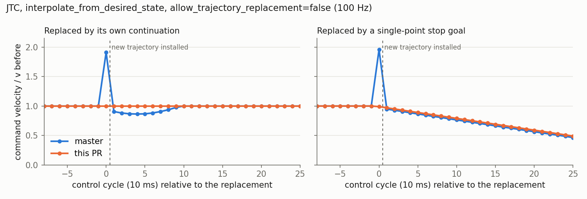
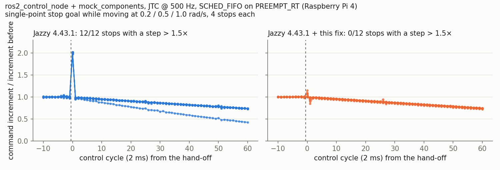

## [JTC] Date the last command at time + update_period

### Problem

With `interpolate_from_desired_state`, a new trajectory is seeded from `(last_commanded_time_, last_commanded_state_)`.

- Since #1306, `last_commanded_state_` (`command_next_`) is sampled at `time + update_period_`.
- But `last_commanded_time_` is still set to `time` (#780, written before #1306).

So the seed is one period ahead of its stamp. Every trajectory replacement then moves the joints one extra period: a **one-cycle ~2× velocity step** at the hand-off, for example when a moving arm is stopped by a new goal.

This affects jazzy, kilted and rolling; humble has neither change. On rolling, it shows whenever a replacement is not blended (`allow_trajectory_replacement: false`, a single-point or holding active trajectory, …).

### Fix

Date the last command at the time it is the setpoint for:

```cpp
last_commanded_time_ = time + update_period_;
```

### Evidence

**Regression test scenario** (100 Hz, `allow_trajectory_replacement: false`): a constant-velocity trajectory replaced by its own continuation (left) or stopped by a single-point goal (right).



**Running `ros2_control_node`** (`mock_components`, 500 Hz, SCHED_FIFO on PREEMPT_RT, Raspberry Pi 4): Jazzy 4.43.1 vs 4.43.1 + this line. A single-point stop goal is sent while moving at 0.2 / 0.5 / 1.0 rad/s.

| | Stops with a one-cycle step | Peak |
|---|---|---|
| Stock | 12/12 | ~2.0× |
| With the fix | 0/12 | ≤ 1.15× |

Repro (generic URDF, controllers, scripts, raw data): [`repro/`](https://github.com/aatb-ch/ros2_controllers/tree/jtc-seed-time-pr-material/repro).



### Tests

- New test `ReplacementSeed/TrajectoryControllerReplacementSeedTest.replacement_does_not_step_the_command/{continuation,stop_goal}` fails on master (1.91×, 1.96×) and passes with the fix.
- With vs without the fix, the results are identical except for the new tests:

| Suite | Passing |
|---|---|
| `test_trajectory_controller` | 759/759 |
| `test_trajectory` | 22/22 |
| `test_tolerances` | 6/6 |
| `test_trajectory_actions` | 144/144 |

### Notes

- ROS 1's JTC bridges from the old trajectory at `next_update_time`, which is consistent, so it never had this step.
- `ur_controllers`' scaled JTC copy (Universal_Robots_ROS2_Driver, jazzy) has the same line and needs the same fix.
- With blending on, a continuation shows a separate small (~1.1×) creep 3–5 cycles after the install. It is unchanged by this PR.
